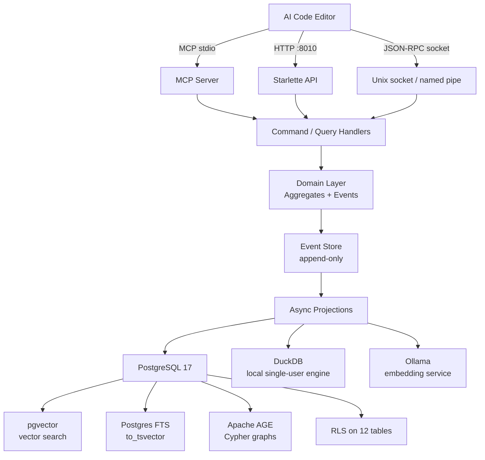
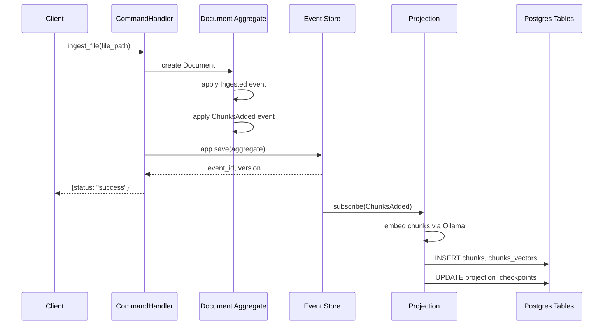

# Corpus-KB

**A local NLP engine for files, transcripts, and code. Ingest, search, ask, extract, and code. No cloud.**

Corpus-KB serves three kinds of users. Non-coders get a browser UI. Novice coders get a CLI with a guided quickstart. Expert researchers get a qualitative-coding pipeline, an OpenAI-compatible API, and MCP tools for coding agents. Everything runs on your machine. Postgres stores the data by default; DuckDB is the single-file local engine ([Storage backends](docs/STORAGE-BACKENDS.md)). Ollama or PostgresML generates embeddings. One server exposes the catalogue over MCP stdio, HTTP REST, and a JSON-RPC socket. An OpenAI-compatible adapter serves `/v1` chat and embeddings. See [Editor integration](#editor-integration).

---

## Two ways to start

Pick the path that fits you. Both end at the same working system.

### The novice path: the browser

No terminal work beyond a few commands. First install the package:

```bash
pip install -e .
```

Then build the browser app once. This needs Node 24 and pnpm; Node is a
build tool only, and the running server stays pure Python:

```bash
pnpm -C ui_src install
pnpm -C ui_src build
```

Then start the stack. `corpus-kb setup` starts Postgres and loads the
schema. `corpus-kb start` starts the server and opens your browser:

```bash
corpus-kb setup
corpus-kb start
```

The browser opens the lifecycle app at `http://localhost:8010/app/`.
The Setup stage shows the system's health in plain language. More
stages — Ingest, Ask, and the rest — land through the UI SPA program
([build plan](docs/research/ui-spa-program-plan.md)).

Details: [docs/UI.md](docs/UI.md).

### The expert path: terminals and APIs

Every operation is reachable programmatically. One line per surface:

- **MCP stdio** for editor agents: `corpus-kb --transport stdio` — [docs/API.md](docs/API.md)
- **HTTP API** with curl examples: [docs/API.md](docs/API.md)
- **OpenAI-compatible adapter** at `/v1` (chat completions, embeddings): [docs/API.md](docs/API.md)
- **JSON-RPC socket** for local automation: [docs/API.md](docs/API.md)
- **CLI**: `corpus-kb ingest`, `corpus-kb search`, `corpus-kb ask` — [docs/getting-started.md](docs/getting-started.md)
- **Tracing** with OpenTelemetry spans: [docs/OBSERVABILITY.md](docs/OBSERVABILITY.md)
- **Offline evaluation** of retrieval and answers: [docs/EVALUATION.md](docs/EVALUATION.md)
- **marimo notebooks** served at `/notebooks`: [docs/NOTEBOOKS.md](docs/NOTEBOOKS.md)
- **Topics** (offline BERTopic over stored embeddings): [docs/TOPICS.md](docs/TOPICS.md)

First time on a terminal? `corpus-kb quickstart` walks you from zero to
a first search. The step-by-step quickstart is in
[docs/getting-started.md](docs/getting-started.md).

---

## What you get

- **Hybrid search** that blends vector similarity, full-text search, and rank fusion, with honest handling of degraded (zero-vector) chunks
- **Reranking** — a local judgment scorer by default, or a true cross-encoder through llama.cpp
- **Answer generation** with per-sentence citations, plus claim-level verification with honest abstention
- **Query routing** — each question goes to vector search, SQL aggregates, or graph traversal
- **Self-query filters** — natural-language filters parsed into parameterized SQL predicates
- **Knowledge graph** with entities, relations, and BFS traversal
- **Ontology-aware extraction** with configurable entity/relation types and pluggable backends (regex, LangExtract, PostgresML, plus opt-in GLiNER2)
- **Pluggable ingestion strategies** — default, transcript, PPTX slide structure, and web page structure, extensible three ways ([docs/INGESTION-STRATEGIES.md](docs/INGESTION-STRATEGIES.md))
- **Website ingestion** — a robots-respecting fetcher with same-domain crawl and heading-section chunks
- **Late chunking** — one model pass per document; chunk vectors pool from their own token spans
- **Qualitative coding** — transcript ingestion, codebooks, deductive and inductive runs, human review, governance reports, and a gated release lifecycle
- **Topics** — offline BERTopic clustering over stored embeddings ([docs/TOPICS.md](docs/TOPICS.md))
- **LlamaIndex RAG backend** with PGVectorStore and Ollama for local vector search
- **Event sourcing** for audit trails and rebuildable projections
- **Multi-tenant Postgres** with row-level security on every table
- **Full-stack installer** with hardware detection, profile-based recommendations, and guided setup
- **MCP, HTTP, socket, and CLI surfaces** so any editor or script can talk to it
- **Browser UI** with drag-and-drop ingest, cited answers, and plain-language health checks ([docs/UI.md](docs/UI.md))
- **Notebooks console** — marimo notebooks served by the running server ([docs/NOTEBOOKS.md](docs/NOTEBOOKS.md))

---

## Architecture



1. **Ingest** a file, directory, or raw text.
2. The pipeline partitions it into chunks and embeds each chunk through Ollama or PostgresML. It extracts entities and relations, then stores the result.
3. Commands append events to the event store; async projections write the read models into Postgres or DuckDB.
4. Your editor queries the read models through search, SQL, or graph traversal.

---

## Event sourcing flow



Events are the source of truth. Projections are derived and can be rebuilt by replaying the event log. Vectors live in the `chunks_vectors` table and are treated as derived data, not event payload.

---

## Documentation

| Page | What it covers |
|------|----------------|
| [Getting started](docs/getting-started.md) | Both paths: the browser for novices, the terminal quickstart for everyone else |
| [Install](docs/INSTALL.md) | Full setup from scratch: Postgres, Python, Ollama, schema, first query |
| [Browser UI](docs/UI.md) | The four pages: Add, Ask, Library, Overview |
| [Features](docs/FEATURES.md) | Ingest, search, quality controls, graph, tags, research subsystem, embedding models, MCP tool reference |
| [Admin](docs/ADMIN.md) | Configuration, schema, multi-tenancy, backups, monitoring, CI/CD |
| [Storage backends](docs/STORAGE-BACKENDS.md) | DuckDB vs Postgres: quickstart, engine selection, migrate-data, ops tuning |
| [Harness playbooks](docs/HARNESS-PLAYBOOKS.md) | Per-project profiles: the decision table, the six-question wizard, tuning |
| [Operations](docs/OPERATIONS.md) | The operator's contract: exit codes, ports, vocabularies, tenancy, the MCP surface |
| [API](docs/API.md) | HTTP routes, the `/v1` OpenAI adapter, curl examples, MCP tool reference |
| [Observability](docs/OBSERVABILITY.md) | OpenTelemetry spans, exporters, zero-cost when off |
| [Evaluation](docs/EVALUATION.md) | Golden sets, recall/MRR/nDCG, answer metrics |
| [Notebooks](docs/NOTEBOOKS.md) | The marimo console and the three example notebooks |
| [Development](docs/DEVELOPMENT.md) | Architecture deep dive, testing, PR workflow, conventions |
| [Research](docs/research.md) | Research command reference, config keys, embedding requirements |
| [Getting started (research)](docs/getting-started.md) | Qualitative coding from zero: the demo, your first transcript, first codebook |
| [Understanding your report](docs/understanding-your-report.md) | Plain-language guide to every governance-report section |
| [Research math](docs/research-math.md) | Every formula, its v5 source, and its calibration provenance |
| [CI](docs/ci.md) | MCP config validation, fail-fast pipeline behavior |
| [FAQ](docs/FAQ.md) | Common questions |
| [Ingestion](docs/INGESTION.md) | Full pipeline documentation: partition, chunk, embed, extract, store |
| [Ingestion strategies](docs/INGESTION-STRATEGIES.md) | Extending ingestion: config mapping, in-process registration, entry-point plugins |
| [Topics](docs/TOPICS.md) | The topic layer: offline BERTopic over stored embeddings, LLM labels, config |
| [Harness distribution](docs/harness-distribution.md) | Packaging and distributing the agent harness pack |
| [Rollback drill](docs/ROLLBACK_DRILL.md) | Practiced procedure for backing out a bad deployment |

The qualitative-coding walkthrough keeps its home in
[docs/getting-started.md](docs/getting-started.md), under "Your own
transcripts".

---

## Editor integration

Editors connect over **MCP stdio** (native, no bridge), the **HTTP API**, or the JSON-RPC socket:

- MCP stdio: `corpus-kb --transport stdio` — the `mcp-configs/` files (Claude Code, Cursor, Codex) and the root `opencode.json` (OpenCode) launch exactly this command. Generic MCP clients such as Hermes or Cline need no config file: they point at the same stdio server. See [docs/harness-distribution.md](docs/harness-distribution.md). The server registers every catalogue operation as an MCP tool; see [docs/FEATURES.md](docs/FEATURES.md) for the tool reference.
- HTTP: `corpus-kb start --transport http --port 8010` — every catalogue operation has a route, plus the `/v1` OpenAI adapter (see [docs/API.md](docs/API.md)).
- JSON-RPC socket: same command, for local automation.
- The research and coding surfaces are first-class CLI commands (`corpus-kb research ...` and `corpus-kb coding ...`). Ingestion has a top-level front door: `corpus-kb ingest` with `--watch` auto-heal, plus `corpus-kb ingest-status` and `corpus-kb ingest-reembed`.

Every catalogue operation is reachable on all four surfaces (MCP, CLI,
HTTP, socket) and returns the same envelope on each. The parity gate in
`tests/test_surface_parity_deep.py` enforces this.

---

## License

MIT License. See `pyproject.toml` for the full text.
