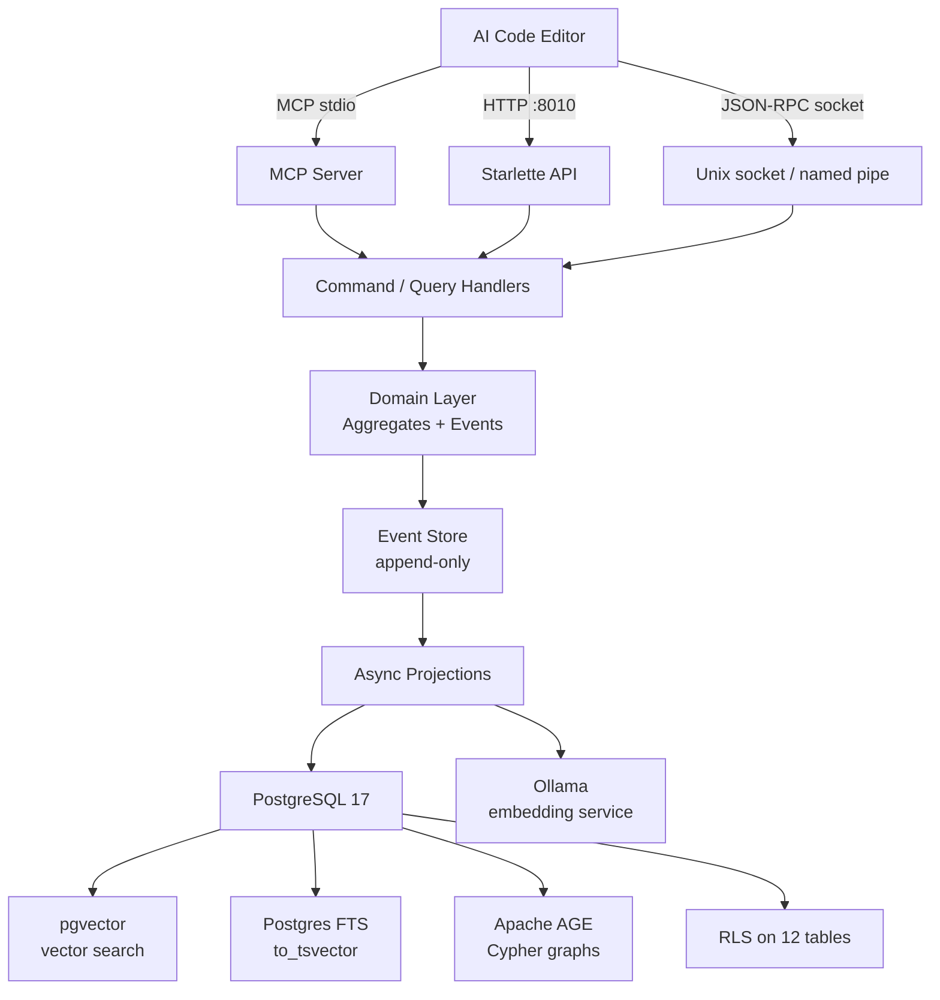
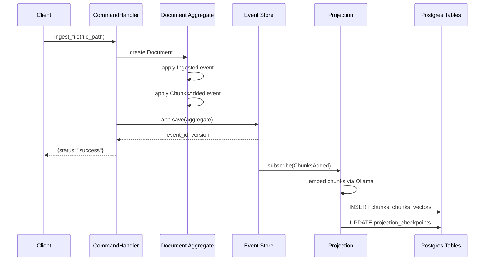

# Corpus-KB

**Local RAG system for AI code editors. Ingest your codebase. Ask questions. Get answers. No cloud.**

Corpus-KB is a private knowledge base for AI coding assistants. It reads your code, documentation, and notes, then answers questions grounded in your actual files. Everything runs on your machine. Postgres stores the data, and Ollama generates embeddings. A local server exposes the whole thing over MCP stdio, HTTP endpoints, and a JSON-RPC socket. See [Editor integration](#editor-integration).

---

## What you get

- **Hybrid search** that blends vector similarity, full-text search, and rank fusion, with honest handling of degraded (zero-vector) chunks
- **Knowledge graph** with entities, relations, and BFS traversal
- **Ontology-aware extraction** with configurable entity/relation types and pluggable backends (regex, LangExtract, PostgresML, plus opt-in GLiNER2)
- **Pluggable ingestion strategies** — map source types in config, register in-process, or ship an entry-point plugin ([docs/INGESTION-STRATEGIES.md](docs/INGESTION-STRATEGIES.md))
- **LlamaIndex RAG backend** with PGVectorStore and Ollama for local vector search
- **Event sourcing** for audit trails and time-travel queries
- **Multi-tenant Postgres** with row-level security on every table
- **Full-stack installer** with hardware detection, profile-based recommendations, and guided setup
- **MCP, HTTP, and socket APIs** so any editor or script can talk to it

---

## Architecture



1. **Ingest** a file, directory, or raw text.
2. The pipeline partitions it into chunks and embeds each chunk through Ollama or PostgresML. It extracts entities and relations, then stores the result.
3. Commands append events to the event store; async projections write the read models into Postgres.
4. Your editor queries the read models through search, SQL, or graph traversal.

---

## Event sourcing flow



Events are the source of truth. Projections are derived and can be rebuilt by replaying the event log. Vectors live in the `chunks_vectors` table and are treated as derived data, not event payload.

---

## Quick start

From zero to a working system in about ten minutes. Each step is one
command. Each command says what it does and what success looks like.

1. Clone the repo.

   ```bash
   git clone https://github.com/moliver28/corpus-kb.git
   cd corpus-kb
   ```

   You now have the source. All later commands run from this folder.

2. Install the package.

   ```bash
   pip install -e ".[dev]"
   ```

   Success: `corpus-kb --version` prints a version number.

3. Start the database and load the schema.

   ```bash
   corpus-kb setup
   ```

   This starts the bundled Postgres container and runs the migrations.
   Success: the last line says the setup finished. The database then
   answers on host port **5433**. That is the container's 5432, published
   as 5433. The packaged config already points there. No Docker? See
   [docs/INSTALL.md](docs/INSTALL.md) for the native-Postgres path
   (port 5432).

4. Check the system.

   ```bash
   corpus-kb doctor
   ```

   Read-only checks. Success: every line says `OK` or `SKIP`. A `FAIL`
   line names its fix. Doctor always exits 0; read the report, not the
   exit code.

5. Pull an embedding model that fits the schema.

   ```bash
   ollama pull qwen3-embedding:8b-q8_0
   ```

   The bundled schema stores 4096-dimension vectors. `qwen3-embedding`
   produces exactly 4096. The older `nomic-embed-text` (768d) does not
   fit. Real (non-degraded) ingest into the bundled schema needs a
   4096-dimension model. Or you change the column yourself. The ingest
   guard and `corpus-kb doctor` catch a mismatch and print the fix.
   See [docs/OPERATIONS.md](docs/OPERATIONS.md).

6. Point the runtime at that model.

   ```bash
   export CORPUS_KB_EMBEDDING_MODEL=qwen3-embedding:8b-q8_0
   export CORPUS_KB_EMBEDDING_DIMENSIONS=4096
   ```

   These variables override the config file (the installer may have
   written the 768d default model there). Success: `corpus-kb doctor`
   reports the model and the dimension check as `OK`.

7. Start the server.

   ```bash
   corpus-kb start --transport http --port 8010
   ```

   Success: the log says the HTTP API listens on port 8010 and the
   socket server is up. Leave this terminal open.

8. Ingest one file from another terminal.

   ```bash
   curl -X POST http://localhost:8010/api/ingest/file \
     -H "Content-Type: application/json" \
     -d '{"file_path": "src/corpus_kb/server_wiring.py"}'
   ```

   Success: the JSON answer says `"status": "success"` and reports a
   chunk count.

9. Search it.

   ```bash
   curl -X POST http://localhost:8010/api/search \
     -H "Content-Type: application/json" \
     -d '{"query": "how does startup work"}'
   ```

   Success: the JSON answer lists scored results.

New to qualitative coding? Run the narrated demo (~5 minutes). The demo
needs a research-grade embedder (1024 dimensions or more), so pull the
qwen3 model from step 5 first. The base `nomic-embed-text` model (768
dimensions) makes the demo abstain by design:

```bash
corpus-kb research demo
```

Then read [docs/getting-started.md](docs/getting-started.md) to run it on
your own transcripts. Ports, exit codes, and vocabularies: see
[docs/OPERATIONS.md](docs/OPERATIONS.md). The full setup guide is
[docs/INSTALL.md](docs/INSTALL.md).

---

## Documentation

| Page | What it covers |
|------|----------------|
| [Install](docs/INSTALL.md) | Full setup from scratch: Postgres, Python, Ollama, schema, first query |
| [Features](docs/FEATURES.md) | Ingest, search, graph, tags, metadata, versioning, embedding models, LlamaIndex RAG |
| [Admin](docs/ADMIN.md) | Configuration, schema, multi-tenancy, backups, monitoring, CI/CD |
| [Operations](docs/OPERATIONS.md) | The operator's contract: exit codes, ports, vocabularies, tenancy, the MCP surface |
| [API](docs/API.md) | HTTP routes, request bodies, curl examples, MCP tool reference |
| [Development](docs/DEVELOPMENT.md) | Architecture deep dive, testing, PR workflow, conventions |
| [Getting started (research)](docs/getting-started.md) | Qualitative coding from zero: the demo, your first transcript, first codebook |
| [Research](docs/research.md) | Research command reference, config keys, embedding requirements |
| [Understanding your report](docs/understanding-your-report.md) | Plain-language guide to every governance-report section |
| [Research math](docs/research-math.md) | Every formula, its v5 source, and its calibration provenance |
| [CI](docs/ci.md) | MCP config validation, fail-fast pipeline behavior |
| [FAQ](docs/FAQ.md) | Common questions |
| [Ingestion](docs/INGESTION.md) | Full pipeline documentation: partition, chunk, embed, extract, store |
| [Ingestion strategies](docs/INGESTION-STRATEGIES.md) | Extending ingestion: config mapping, in-process registration, entry-point plugins |
| [Harness distribution](docs/harness-distribution.md) | Packaging and distributing the agent harness pack |
| [Rollback drill](docs/ROLLBACK_DRILL.md) | Practiced procedure for backing out a bad deployment |

---

## Editor integration

Editors connect over **MCP stdio** (native, no bridge), the **HTTP API**, or the JSON-RPC socket:

- MCP stdio: `corpus-kb --transport stdio` — the `mcp-configs/` files for Claude Code, Cursor, Codex, and OpenCode launch exactly this command. The server registers the catalogue operations plus the research/coding/release surfaces as MCP tools; see [docs/FEATURES.md](docs/FEATURES.md) for the tool reference.
- HTTP: `corpus-kb start --transport http --port 8010` — every ingest/search/graph/research surface has a route (see [docs/API.md](docs/API.md)).
- JSON-RPC socket: same command, for local automation.
- The research and coding surfaces are first-class CLI commands (`corpus-kb research ...` and `corpus-kb coding ...`). Ingestion has a top-level front door: `corpus-kb ingest` with `--watch` auto-heal, plus `corpus-kb ingest-status` and `corpus-kb ingest-reembed`.

Both stdio and HTTP serve the same shared tool functions, so envelopes match across surfaces. The parity gate in `tests/test_surface_parity_deep.py` enforces this.

---

## License

MIT License. See `pyproject.toml` for the full text.
