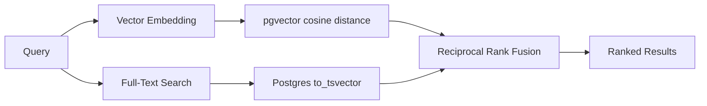
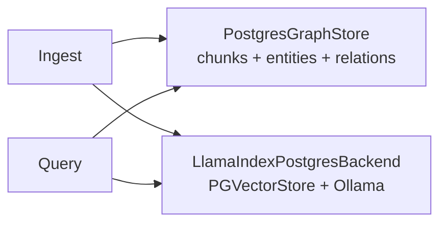

# Features

Corpus-KB turns your local files into a searchable, queryable knowledge base. This page explains what you can do once the server is running.

---

## Ingest anything

Send files, directories, or raw text into the pipeline. Corpus-KB detects the type automatically and chooses the right chunking strategy.

| Input | How it is handled |
|-------|-------------------|
| File | Detected by extension: code, markdown, plain text, or PPTX decks (slide-level structure + metadata) |
| Directory | Recursively ingests every supported file |
| Raw text | Optional type hint: code, markdown, or text |
| Website | `corpus-kb ingest-url URL` — robots-respecting fetch (optional same-domain crawl), heading-section chunks with OG/JSON-LD metadata |

Detection and chunking run through a pluggable **ingestion strategy**. The built-in `default` strategy preserves the classic behavior; built-in `transcript`, `pptx_structure`, and `web_structure` strategies give interviews, slide decks, and web pages first-class structure-aware chunking. Map source types to strategies in `config.yaml`, register one in-process, or ship one as an entry-point plugin — see [Ingestion strategies](INGESTION-STRATEGIES.md).

**Website ingestion scope:** fetching is static-HTML (no JavaScript rendering) and robots-respecting. Private addresses are blocked by default; `web.allow_private_addresses` opts out for genuinely local targets. The fetcher size-caps the stream and crawls same-site only (hostname modulo `www`). JS-heavy single-page apps yield their shell content only.

### Code chunking

Code files are split using tree-sitter. Chunks respect AST boundaries: functions, classes, and methods stay intact. Supported languages include Python, JavaScript, TypeScript, Rust, Go, Java, C, C++, and many more.

### Markdown chunking

Markdown is split at headings. Each section becomes a chunk with its heading path preserved, so search results know which section they came from.

### Text chunking

Plain text is split by semantic gaps. The chunker looks for topic shifts rather than cutting at fixed sizes, though `max_size` and `overlap` still apply.

### Pipeline stages

The ingest pipeline runs five stages:

1. **Partition** - Break the file into semantic elements.
2. **Chunk** - Group elements into coherent chunks.
3. **Embed** - Send each chunk to the configured embedding provider (Ollama or PostgresML) and store the vector in Postgres via pgvector.
4. **Extract** - Run the ontology-aware extractor to find entities and relations.
5. **Store** - Persist chunks, vectors, entities, and relations directly to Postgres. The event store records what happened for audit and replay.

If the embedding provider is unavailable, embedding falls back to zero vectors. The affected chunks are flagged degraded in Postgres. Search leaves them out of vector results by default (`retrieval.exclude_degraded: true`) while reporting the exclusion in the response. `corpus-kb ingest-reembed` repairs them once the provider is back.

---

## Hybrid search

Search combines two signals and merges them with Reciprocal Rank Fusion.



- **Vector search** finds chunks that are semantically similar, even when the wording differs.
- **Full-text search** finds exact and near-exact keyword matches using Postgres `to_tsvector`.
- **RRF fusion** merges the two ranked lists into a single result list without needing calibrated scores.

Degraded (zero-vector) chunks are excluded from the vector arm while `retrieval.exclude_degraded` is `true` (the default). The response's `degraded_excluded` field says exactly what was left out.

You can filter by source type (`code`, `markdown`, `text`) and request surrounding context chunks.

---

## Knowledge graph

Entities and relations are first-class citizens. The extractor recognizes things like classes, functions, concepts, people, organizations, and products. It links them with typed relations such as `PART_OF`, `MENTIONS`, `DEFINED_AS`, and `RELATED_TO`.

### Ontology-aware extraction

Entity and relation types are defined in `config/ontology.yaml`. The extractor validates every extracted entity and relation against this vocabulary, rejecting types that don't match. This prevents noise from inconsistent typing.

Three extraction backends ship by default, plus an opt-in fourth:

| Backend | Config value | Description |
|---------|-------------|-------------|
| Regex | `regex` | Zero-dependency fallback. Fast, deterministic, no LLM calls. |
| LangExtract | `langextract` | LLM-based extraction with recorded fixtures for deterministic CI. |
| PostgresML | `pgml` | In-database ONNX NER with regex fallback. Requires `pgml` extension. |
| GLiNER2 | `gliner` | Opt-in mention-level NER (`fastino/gliner2-large-v1`); entities only, no relations. Needs the `ner` extra and `extraction.gliner.enabled: true`. |

You can:

- Search entities by name or type.
- Add entities and relations manually through the API or MCP tools.
- Traverse the graph with BFS from any starting entity.
- Query relations through Apache AGE Cypher if you enable the AGE extension.

---

## Tags and metadata

Organize documents without moving files.

- **Tags** are colored labels you can apply to any document.
- **Metadata** is a key-value store scoped to a document or global to the tenant.

Both are tenant-isolated through RLS and queryable through SQL.

---

## Versioning and time travel

Corpus-KB uses event sourcing. Every ingest, update, and delete appends an immutable event to the event store. Projections read those events and build the Postgres tables.

This gives you:

- A complete audit trail.
- The ability to replay projections from any point in time.
- Tagged checkpoints for important moments.

The event store is the source of truth; the Postgres tables are read models that can be rebuilt.

---

## Configurable embeddings

Switch embedding providers and models by changing `config.yaml`:

```yaml
embedding:
  provider: ollama  # "ollama" | "pgml"
  model: qwen3-embedding:4b
  dimensions: 2560
  batch_size: 32
```

To use PostgresML for in-database embeddings (requires the `pgml` extension):

```yaml
embedding:
  provider: pgml
  model: intfloat/e5-small-v2
  dimensions: 384
```

The `dimensions` value must match the model output exactly. pgvector enforces the width with no padding and no truncation. The shipped schema stores `halfvec(2560)`; any other width needs a column migration first (migration 025 is the current regime).

### Late chunking (document pipeline)

`embedding.late_chunking: true` (the default) requests **late chunking**. The document is tokenized and run through the model ONCE. Each chunk's vector is mean-pooled from the token states of its exact span. So every chunk vector has seen the whole document (better pronoun/coreference handling, no context bleeding at chunk boundaries). Documents longer than the model context are processed in sliding windows.

Activation is capability-checked and honest — late chunking runs only when ALL of:

- the `latechunk` extra is installed: `pip install -e ".[latechunk]"` (sentence-transformers + transformers + torch),
- `embedding.model` is a token-level family (`qwen3-embedding*` — Ollama's endpoint serves pooled vectors only, so token states come from the local HF stack),
- `embedding.dimensions` matches the activated model's real output width (Qwen3-Embedding-0.6B = 1024).

Otherwise the run uses pooled embeddings and the ingest result says so. `embedding_mode` records `"late-chunking"` or `"pooled"` (shown on the CLI as `embedding:`). `embedding_note` names the exact condition that fell back. Some chunk vectors cannot be located in the document text, or lack source spans. Those vectors pool individually rather than silently pool an unrelated region.

---

## LlamaIndex RAG backend

In addition to the built-in PostgresGraphStore search path, Corpus-KB includes an optional LlamaIndex RAG backend. The backend uses PGVectorStore for vector storage and Ollama for local embeddings.



Key features:

- **PGVectorStore** for HNSW-indexed vector search in Postgres.
- **Ollama embeddings** — never falls back to OpenAI or cloud providers.
- **Dimension mismatch detection** — raises `DimensionMismatchError` if configured dimensions don't match the store.
- **RagBackend protocol** — `src/corpus_kb/storage/rag_backend.py` defines a `Protocol` interface so future backends can be added without changing callers.
- **Additive** — the LlamaIndex backend runs alongside the existing PostgresGraphStore path, not replacing it.

The backend is defined in `src/corpus_kb/storage/llamaindex_backend.py` and implements the `RagBackend` protocol from `src/corpus_kb/storage/rag_backend.py`.

---

## Multi-tenancy ready

Every table has row-level security policies keyed to `app.current_tenant_id`. The default tenant is `00000000-0000-0000-0000-000000000001`. In the future, adding real multi-tenancy is a matter of issuing tenant-scoped tokens and setting the tenant context per request.

---

## MCP tool reference

The MCP stdio server is real: `corpus-kb --transport stdio` serves the
tools below over stdin/stdout (`src/corpus_kb/mcp_server.py`). The tool
list is GENERATED from the same registry the CLI and HTTP surfaces use.
That registry is the parity catalogue (`src/corpus_kb/contracts/`) plus
the research/coding rows in `src/corpus_kb/surface_registry.py`. A new
catalogue row gains an MCP tool automatically. The parity gate
(`tests/test_surface_parity_deep.py`) holds every surface to the same
envelope.

Honest caveats:

- The `autoApprove` lists in `mcp-configs/*.json` keep legacy names from
  the original design (for example `search_context`, `sql_query`) that
  have no MCP tool today. Unknown names are harmless: they never match.

| Surface | Tool | Description |
|---|---|---|
| Ingest | `ingest_text` | Ingest raw text with a source label and a document type |
| Ingest | `ingest_file` | Ingest one file; the document type is auto-detected |
| Ingest | `ingest_directory` | Ingest the supported files under one directory in one walk |
| Ingest | `ingest_url` | Fetch (or crawl) a website and ingest its HTML pages |
| Ingest | `ingest_status` | Recent runs from the `ingest_runs` ledger |
| Ingest | `ingest_reembed` | Re-embed degraded (zero-vector) chunks |
| Documents | `list_documents` | List ingested documents |
| Documents | `delete_document` | Delete one document by ID |
| Graph | `add_entity` | Add one entity to the knowledge graph |
| Graph | `add_relation` | Add one relation between two entities |
| Search | `search` | Hybrid vector + full-text search |
| Search | `query` | Route one question to the vector, SQL, or graph backend |
| Search | `verify_answer` | Check each claim of an answer against the cited chunks |
| Research | `research_ingest_transcript` | Ingest one transcript: turns, roles, exchanges |
| Research | `research_ingest` | Dynamic ingest of file/dir/glob with dedup |
| Research | `notebook_ask` | Grounded Q&A with cited sentences |
| Research | `notebook_evidence` | Evidence for one code: ranked units |
| Research | `notebook_uncoded` | Uncoded units ranked by margin |
| Research | `notebook_overlap` | Code overlap: flagged pairs and confusion |
| Research | `research_report` | Governance report: exhaustiveness, overlap, IRR, G3 audit |
| Coding | `coding_run` | Deductive coding run against a codebook version |
| Coding | `inductive_run` | Inductive pass: summaries, clusters, proposed codes |
| Coding | `codebook_promote` | Promote a proposed code (human gate) |
| Review | `review_execute` | Record one accept/override review decision |
| Release | `release_assess` | Compose every release gate; writes nothing |
| Release | `release_request` | Open a draft release pinned to the content hash |
| Release | `release_review` | Show the review packet: gates, waivers, next actions |
| Release | `release_execute` | Execute the release with a named approver |
| Release | `release_status` | Stage, release state, blockers, next command |
| Release | `release_compare` | Diff the manifests of two releases |
| Cycle | `research_cycle` | Full pipeline with halt gates; long-running, synchronous |
| Cycle | `research_demo` | Narrated demo pipeline; long-running, synchronous |

The HTTP equivalents are listed in [API.md](API.md); the CLI command
paths live in the surface registry (`src/corpus_kb/surface_registry.py`),
the authoritative CLI↔MCP-name mapping. Each tool takes the same
parameters as its HTTP route; every tool returns the shared envelope its
catalogue row declares.

---

## Next steps

- [Install Corpus-KB](INSTALL.md)
- [Ingestion pipeline details](INGESTION.md)
- [Ingestion strategies](INGESTION-STRATEGIES.md)
- [Admin guide: configuration and maintenance](ADMIN.md)
- [API reference with curl examples](API.md)
- [Development guide](DEVELOPMENT.md)
- [FAQ](FAQ.md)
